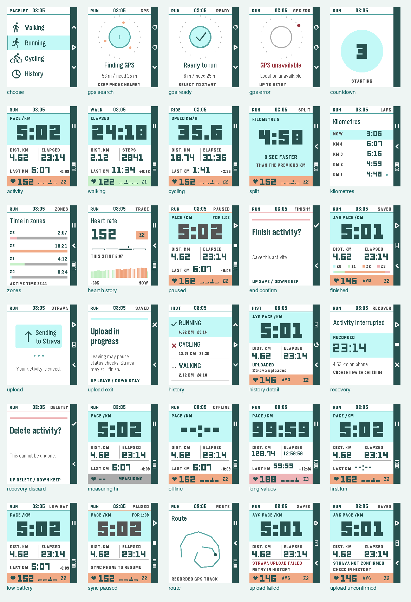

# Pacelet

Pacelet is a Pebble watchapp for recording outdoor activities. The watch acts
as the controller and live dashboard, while the paired phone provides GPS.
Optional Strava upload uses a personal-credentials model: there is no shared
backend or hosted OAuth service, so users provide their own Strava API details
in the Pebble configuration page.

Pacelet targets `emery` exclusively. Its interface, resources, emulator
tooling, and manual QA are designed for the Pebble Time 2's native 200x228
display.

## Features

- Walking, Running, and Cycling activity modes.
- Guided watch flow: choose activity from a compact menu, wait for GPS lock, run
  a 3-second countdown, then record.
- Phone GPS lock required before starting an activity.
- Walking shows elapsed time, distance, steps, and heart rate.
- Running leads with smoothed pace, with distance, elapsed time and heart rate.
- Cycling leads with smoothed speed in km/h, with distance, elapsed time and
  heart rate.
- The top status bar keeps the current clock visible throughout the app.
- Each completed kilometre triggers a vibration and a six-second split summary
  with kilometre time, split pace or average cycling speed, and current HR.
- Watch screens use a right-side action rail with icons aligned to the hardware
  buttons.
- Heart rate is read from Pebble Health when supported by the device.
- Activities can be started, paused, resumed, finished, and saved from the
  watch.
- Interrupted activities are checkpointed on both sides and offered for
  resume, finish, or confirmed discard after the app or phone restarts.
- Phone-side recorder stores recent activity summaries, GPS points, and
  heart-rate samples in Pebble JavaScript `localStorage`.
- Optional personal Strava upload using credentials entered in the Pebble
  configuration page.
- Watch-side Activity History menu for recent activity status, TCX export, and
  Strava retry actions.
- Paceboard's soft aqua and deep teal palette, with pace first for Running.
- Last completed kilometre and change from the previous split.
- Focused kilometre, time-in-zone and rolling-minute HR pages.
- Smooth GPS acquisition and short transition animations, with Full / Key moments /
  Off motion settings. Optional motion reduces at low battery.
- Safe BACK behavior and confirmation before leaving a pending save or upload.
- Deterministic Node test harness for the core tracking logic.

## Watch Controls

- Choose: `UP` and `DOWN` change activity type or Activity History; `SELECT`
  opens the selected flow.
- GPS/Ready: `UP` refreshes GPS, `DOWN` changes activity type, and `SELECT`
  starts the countdown once GPS is locked.
- Active: `UP` pauses the activity.
- Paused: `UP` resumes and `SELECT` opens the finish confirmation.
- Finish confirmation: `UP` saves the activity and `DOWN` cancels.
- Partial activity recovery: `UP` waits for fresh GPS and resumes, `SELECT`
  finishes the checkpointed activity, and `DOWN` opens discard confirmation.
- Discard confirmation: `UP` permanently discards the matching draft and
  `DOWN` cancels.
- Active/Paused: `DOWN` cycles dashboard, kilometres, zones, HR history and route.
  `SELECT` returns from a secondary page. Pages return after 20 seconds.
  The filled indicator marks your current page. Route shows recorded points with
  gaps at pauses and recovery boundaries.
- BACK pauses Active, cancels a countdown or confirmation sheet, and keeps a
  paused/interrupted activity open. During a save/upload it offers Leave / Stay;
  Strava may still complete an upload after leaving.
- Saved: `UP` starts another activity, `SELECT` opens history, and `DOWN` returns
  to the picker. These actions wait for the phone's save acknowledgement.
- Activity History: `UP` and `DOWN` choose a saved activity or Back; `SELECT`
  opens the detail screen. In detail, `UP` opens TCX export on the phone,
  `SELECT` retries Strava, and `DOWN` returns to the list.

Startup flow:

```text
Choose Activity -> GPS lock status -> 3,2,1 countdown -> Activity started
```

## Project Layout

- `CHANGELOG.md`: Versioned history following Keep a Changelog and SemVer.
- `src/c/main.c`: Small watch entry point and Pebble service lifecycle.
- `src/c/pacelet.h`: Shared watch state and enums.
- `src/c/pacelet_model.c`: State initialization, elapsed-time helpers, activity
  labels, and HR-zone rules.
- `src/c/activity_controller.c`: Button actions, activity transitions, timers,
  kilometre splits, and watch-side HR sampling.
- `src/c/watch_services.c`: Persisted settings and AppMessage transport.
- `src/c/watch_ui.c`: Snapshot-based Emery renderer, layers and burst motion.
- `docs/watch-architecture.md`: Watch module boundaries, state flow, and a
  guide to where changes belong.
- `docs/design/paceboard/README.md`: Selected design, full preview and motion
  specification. Earlier studies are retained under `docs/design/`.
- `src/pkjs/index.js`: PebbleKit JS entry point and event coordination.
- `src/pkjs/activity_store.js`: Settings and saved-activity persistence.
- `src/pkjs/activity_recovery.js`: Draft checkpoint, restore, and
  session-matching coordination.
- `src/pkjs/gps_service.js`: Phone geolocation watch, polling, and live watch
  updates.
- `src/pkjs/strava_service.js`: Strava token exchange, upload, and polling
  orchestration.
- `src/pkjs/tracker_core.js`: Pure GPS/activity logic used by the phone runtime
  and tests.
- `src/pkjs/strava.js`: Pure Strava settings, OAuth request, TCX, multipart,
  and upload-status helpers.
- `src/pkjs/history_messages.js`: Compact saved-activity history payloads for
  the watch.
- `src/pkjs/config_page.js`: Embedded Pebble configuration page for personal
  Strava credentials.
- `docs/phone-architecture.md`: Phone-side module boundaries and change guide.
- `resources/images/`: Generated monochrome Material Symbols icon resources
  used by the watch UI.
- `store-assets/`: Pacelet's pixel-native app-store icon and SVG master.
- `test/tracker_core.test.js`: Test harness for tracking behavior.
- `test/strava.test.js`: Test harness for TCX/export/upload helpers.
- `test/runtime_services.test.js`: Test harness for persistence, GPS lifecycle,
  and Strava network orchestration.
- `tools/generate_activity_icons.js`: Rebuilds the walking/running/cycling icon
  PNG resources without external dependencies.
- `tools/generate_brand_assets.js`: Rebuilds the 25px Pebble menu icon and
  144px/512px app-store artwork from one 16x16 pixel grid.
- `tools/manual_emery_gps.py`: Manual emulator harness that runs the app in
  `emery` with simulated phone GPS.
- `tools/screenshot_emulator.py`: Real emulator screenshot harness, defaulting
  to `emery`.
- `tools/pypkjs_gps_sim/sitecustomize.py`: Local `pypkjs` geolocation shim used
  only by the emulator harnesses.
- `tools/render_watch.py`: Renders the shipping C UI with native PebbleOS fonts
  and graphics, and checks every transition end frame.
- `screenshots/`: Generated SVG/PNG design mockups. Real emulator captures go
  under `screenshots/emulator/` and are ignored by git.

## Personal Strava Upload

This app can upload saved activities to Strava without a separate companion app
or backend by storing personal Strava credentials in the Pebble configuration
page.

Open the app settings from the Pebble/Rebble phone app and enter:

- Strava client ID
- Strava client secret
- Refresh token, or a one-time authorization code that the app can exchange for
  tokens
- Optional current access token and expiry
- Whether to auto-upload after saving an activity

Generate Strava authorization in a desktop browser with callback domain
`localhost` and `read,activity:write` scope, then paste the one-time `code`
into settings. A read-only token cannot upload activities.

When an activity is saved, PebbleKit JS refreshes the access token if needed,
generates a TCX file with GPS and heart-rate trackpoints, uploads it to Strava,
then polls Strava briefly for the resulting activity ID.

If you paste a one-time authorization code into settings, the app exchanges it
for access/refresh tokens when you save the configuration, then clears the code.
The authorization code is short-lived and can only be exchanged once. It is
tied to the Strava API client, not to a particular Pebble watch or installation.
If reinstalling Pacelet loses the locally stored refresh token, generate a fresh
authorization code instead of reusing the previous one.

Strava API apps may need active developer API access from Strava's dashboard.
If every API call fails with `Application Status Inactive`, check the app's
dashboard/subscription state rather than reauthorizing the same inactive app.

## Saved Activities And Export

Activities are saved on the paired phone in PebbleKit JS `localStorage` under:

```text
pebbleTrackerActivities
```

While recording, the current activity is also checkpointed about every 15
seconds under `pebbleTrackerActiveActivity`. The watch persists compact
recovery metadata about every 30 seconds and whenever its app closes or the
activity changes state. On the next launch, Pacelet reconciles both sides and
offers the phone draft for resume, finish, or confirmed discard. Resume waits
for a fresh GPS lock and begins a new GPS segment, so time spent powered off and
the straight-line jump to the new fix are not counted. At most the work since
the phone's most recent checkpoint can be lost in a sudden interruption.

Open Activity History from the watch activity picker to see recent saved
activity summaries. Each activity detail has:

- `Export TCX`: opens a generated TCX page on the phone. The Pebble config
  browser can block direct file sharing and downloads, so the export page shows
  the raw XML with a `Copy TCX` action.
- `Retry Strava`: retries the Strava upload using the current credentials.

The Pebble/Rebble configuration page still shows recent activity status, but
history actions live on the watch because configuration applets close when they
return a response. The configuration page also controls watch motion and HR
thresholds. Paceboard uses one fixed palette; existing history/settings survive
the removal of the former theme toggle.

From version 0.6.0, newly recorded activities include GPS diagnostics in the
Pacelet TCX: recording app/filter version, point accuracy, original coordinates
where smoothing was applied, and a bounded history of rejected fixes, GPS
restarts, pauses and recoveries. Keep this export when reporting a tracking
problem. The Strava GPX may not retain this metadata. Both upload and phone
export preserve gaps as separate tracks and keep the recorded distance; missing
route sections are not estimated. Older recordings cannot gain diagnostics or
pause boundaries retrospectively.

See [GPS recovery and filtering](docs/gps-recovery.md) for the investigation,
algorithm, tradeoffs and validation.

Important caveat: this is a personal-credentials integration rather than a
managed OAuth service. Pacelet has no shared backend, so each user needs their
own Strava API client ID and secret. The client secret and tokens are stored in
Pebble app settings on the phone and should never be shared.

## Screenshots

Regenerate the UI and brand icon PNG resources with:

```sh
npm run icons
```

Regenerate the current SVG screen mockups with:

```sh
npm run screenshots
```

Generate PNG previews too with:

```sh
npm run screenshots:png
```

Capture a real `emery` emulator screenshot of the current app with:

```sh
npm run screenshots:emulator
```

Capture the main app flow from the `emery` emulator in one command with:

```sh
npm run screenshots:emulator:all
```

The screenshot renderer uses Emery's native 200x228 screen, matching the manual
emulator harness and Pacelet's only supported watch platform.

The fast renderer compiles the actual `watch_ui.c` against the sibling
`../pebble-watchface-agent-skill/watchface-lab/renderer` PebbleOS graphics engine.
Run `pebble build` first to generate SDK headers/resources. The sibling's compiled
firmware objects are read-only inputs; app objects stay in a temporary directory.
It writes 2× PNGs, SVG wrappers, a full overview, and motion GIFs. Each transition's
last frame must exactly match its static target. `tools/render_screenshots.js`
remains the historical software mock renderer.

The emulator screenshot harness builds and installs the PBW, drives the app to a
selected screen or the main app flow, and saves real captures under
`screenshots/emulator/`. The all-screens mode captures choose, GPS searching,
GPS ready, countdown, activity, split, paused/finish, upload exit, four data
pages, history/detail and recovery/discard states with ordered filenames. It
starts a clean emulator once and advances through the flow, reinstalling once
to verify recovery. Pass `--isolated` for a fresh emulator per capture. Use
`--reuse-emulator` only when the running phone simulator already has the GPS shim.
Useful variants:

```sh
npm run screenshots:emulator -- --all-screens --activity cycling
npm run screenshots:emulator -- --screen gps-ready
npm run screenshots:emulator -- --screen activity --activity cycling
npm run screenshots:emulator -- --screen paused --reuse-emulator
npm run screenshots:emulator -- --screen recovery
npm run screenshots:emulator -- --screen recovery-discard
```

Current mockup examples are emitted as both `.svg` and `.png` files for each
screen. The SVG paths are:

- `screenshots/choose-running.svg`
- `screenshots/history-list.svg`
- `screenshots/history-detail.svg`
- `screenshots/gps-search.svg`
- `screenshots/gps-ready.svg`
- `screenshots/countdown.svg`
- `screenshots/walking.svg`
- `screenshots/running.svg`
- `screenshots/split-running.svg`
- `screenshots/paused.svg`
- `screenshots/cycling.svg`
- `screenshots/recovery.svg`
- `screenshots/recovery-discard.svg`

## Tests

Run the deterministic tracker tests and JS syntax checks:

```sh
npm test
```

The test harness covers activity type mapping, GPS lock gating, smoothed
Walking/Running pace, Cycling speed, pause/resume distance handling,
heart-rate samples, finish summaries, interrupted-runtime restoration,
checkpoint corruption, session-safe recovery actions, idempotent completion,
TCX generation, token refresh payloads, multipart Strava upload bodies, watch
history payloads, activity export pages, and the config page.

## Manual Emulator GPS Harness

Run the app in the `emery` emulator with simulated phone GPS:

```sh
npm run manual:emery:gps
```

By default the harness:

- kills any existing Pebble emulator so the local `pypkjs` GPS shim is loaded,
- builds and installs the PBW into the `emery` emulator,
- selects Running and presses `SELECT` to request GPS,
- waits 30 seconds before returning GPS fixes,
- then emits points every 5 seconds around a slightly jittered 1 km loop, and
- streams Pebble logs until you press `Ctrl+C`.

Useful variants:

```sh
npm run manual:emery:gps -- --activity cycling
npm run manual:emery:gps -- --activity walking --auto-start-activity
npm run manual:emery:gps -- --no-auto-request-gps
npm run manual:emery:gps -- --lock-delay-s 10 --loop-distance-m 2000
```

The GPS simulator is injected through `PYTHONPATH` only for the spawned emulator
phone runtime. It does not add dummy GPS behavior to the production app bundle.

## Build

Build the Pebble app with:

```sh
pebble build
```

The PBW is written to `build/pebble-activity-tracker.pbw`.

## Strava

The current Strava path is the personal credentials flow described above. A
public/distributed Strava integration would need a tiny OAuth backend so the
Strava client secret is not shipped inside the Pebble app bundle.

## License

MIT. See `LICENSE.md`.

## Paceboard release



[Full design and motion study](docs/design/paceboard/README.md) ·
[Next iteration](docs/roadmap.md)

Production releases keep the store UUID. After validation and a Conventional
Commit/version/changelog update, push the commit and run the authenticated
`pebble publish` CLI with release notes and the Emery store screenshots.
No production bundle is installed on a physical watch by this workflow.
