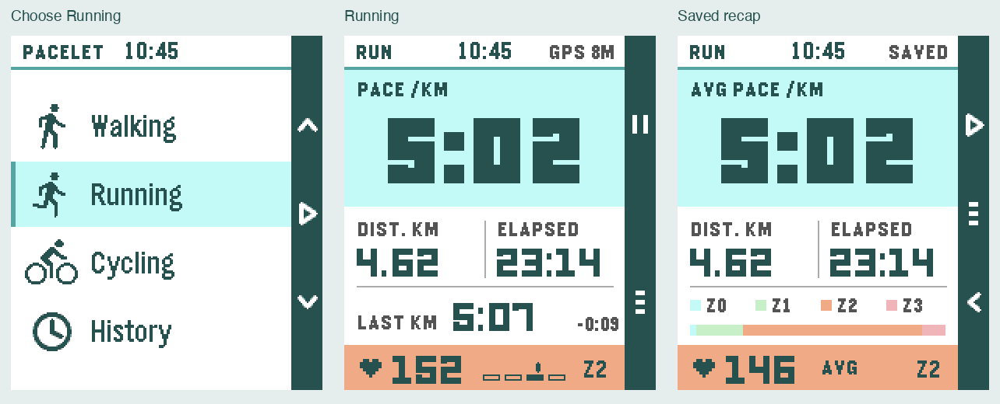

# Paceboard — selected redesign

2026-11-06. Paceboard is now integrated into the production app for release
0.7.0. The review player below preserves the selected design study; current
shipping screens are shown in [the native overview](../../../screenshots/paceboard-overview.png).
`tools/render_watch.py` renders the actual production C, rather than the earlier
sample-frame catalogue.



[Interactive full preview](index.html) · [Full screen overview](overview.png) · [GPS motion](gps-lock.gif) ·
[Full motion walkthrough](walkthrough.gif)

## Decisions incorporated

- Pace is the running hero. Cycling leads with speed; Walking keeps elapsed
  time and steps. Distance is labelled **DIST. KM**.
- Last KM stays in its own row, with the change from the previous completed
  kilometre. No current-kilometre ring or distance-to-next-kilometre indicator.
- A heart, value, exact zone marker and zone number identify the compact HR
  strip. No redundant HEART RATE heading or footer.
- One palette throughout; the proposed phone settings have no dark-mode switch.
- The clock and action rail stay in place on every screen and transition.

## Palette and type

All watch colours are exact Emery entries; the rendered images include LCD
colour correction. Deep teal (`005555`) replaces pure black in figures and the
rail. The large pace panel is pale aqua (`AAFFFF`), with white supporting
surfaces, teal (`00AAAA`) accents, grey (`555555`) labels and fine grey rules.
HR zones use aqua, mint (`AAFFAA`), amber (`FFAA00`) and coral (`FFAAAA`), paired
with numeric zone labels and a position marker. Colour is never the sole cue.

The hierarchy retains LECO 60 for typical pace, LECO 26 for supporting metrics,
and Gothic 14/18/24 for labels and explanatory text. Long fields measure and
step down; they are not squeezed or allowed to wrap. Layouts were checked with
`99:59`, `128.74`, `12:59:59`, `188` and `+12:34`.

## GPS acquisition

The former striped icon was a preview-scaling bug. Native activity masks now
scale by complete pixel runs. GPS acquisition itself now uses Orbit's stronger
idea: a quiet 25 m target ring and three accuracy markers around it.

- The markers glide at a steady angular speed, rendered at **30 fps** in the
  preview. There is no one-second stepping.
- Their radius follows received accuracy, at 1.2 px/m, capped at 60 px. A new
  fix changes the number immediately; the radius eases into its new position.
- On lock, the markers converge, the target ring completes, then a check draws.
- The markers illustrate accuracy, not a claimed satellite count. The sample
  sequence uses distinct 58 m, 32 m and 8 m fixes, not interpolated readings.
- Production should animate only while acquisition is visible, with an initial
  15 s orbit budget; after that, use short responses to new fixes. Never switch
  to a visibly jerky low frame rate. Cancel on ready/error/exit or loss of focus.

## Motion language

Paper panels move; measured values stay honest. One short burst runs at a time.
Buttons act immediately and cancel an obsolete transition. Native end frames
match their static screens exactly, so no overlays or offsets remain at rest.

| Event | Treatment | Duration |
| --- | --- | --- |
| Picker change | Selected aqua row glides to the next activity | 240 ms |
| GPS search | Constant-speed orbital movement; one 120-degree cycle permutes the three markers seamlessly | 3.4 s per preview cycle, 30 fps |
| New GPS fix | Marker radius eases inward to the received accuracy | 320 ms |
| GPS lock | Markers converge, ring completes, check draws | 480 ms |
| Countdown | One small two-part expansion per numeral; no digit tween | 280 ms each |
| GO | Countdown disc settles into the pace panel as supporting rows rise | 440 ms |
| Kilometre split | Aqua sheet rises over content; header and rail stay pinned | 280 ms in; 240 ms out |
| Split hold | Six seconds in the direct split preview; dismissible early | Controller-owned |
| Pages | Kilometres, zones and HR history push vertically | 240 ms |
| Pause/resume | State and values respond immediately; one short rule/field sweep | 200 ms |
| Finish confirmation | A sheet enters above the paused screen | 240 ms |
| Saved | Draw a check, a brief restrained confetti burst, then settle into the recap | 760 ms |
| New HR reading | Brief icon emphasis only on an actual sample | 120 ms |
| Zone change | Directional wipe after hysteresis; reading changes immediately | 320 ms |
| Upload | One short request cue, then a still waiting state; never a fabricated percentage | 720 ms |

Full / Key moments / Off is the only proposed appearance-related setting. The
preview honours reduced motion and has no autoplay on load. Production should
also cancel effects on unload/focus loss and reduce optional effects on low
battery. Haptics remain functional in all motion modes: a short GPS lock tap,
countdown taps and distinct GO, lub-dub split, pause/resume confirmation and a
saved acknowledgement. The split and lock also trigger the backlight.

## Full view

The interactive preview includes 34 native screen states: picker, search,
improving fix, ready/error, countdown, walking/running/cycling, first kilometre,
offline and measuring states, long values, split, kilometre/zone/HR pages,
pause, finish/save, upload/exit confirmation, history and recovery/discard.

The curated tour illustrates a Running flow; the screen selector also exposes
Walking, Cycling and exceptional fixtures. It is a visual prototype with sample
recordings, not a simulated GPS recorder or a complete controller test. The
phone-settings view preserves personal Strava setup and recent activities,
removes the theme toggle, and exposes the motion preference.

## Production implementation

The watch uses central state/overlay setters, captured view data, four drawing
layers, and one UI-owned frame timer. Actual phone/watch metrics replace all
preview fixtures. Three focused pages cycle on DOWN and return on SELECT or
a 20-second timeout. BACK pauses the recording even on a focused page.

Settings expose Full / Key moments / Off motion. The fixed palette ignores the
legacy theme flag, retaining its protocol slot and old settings reader. Existing
history and credentials are preserved. Saving waits for a phone acknowledgement;
Strava upload/exit states keep server-side status honest.

Use `npm test`, `pebble build`, `npm run screenshots:png` and
`npm run screenshots:emulator:all` for the shipping implementation. Native QA
checks motion cancellation, focus, low battery and modes, plus exact final frames.
Physical-watch frame pacing, sunlight, haptics and battery endurance still need
on-device assessment; emulator/native checks cannot measure those.

The active/hollow page bars and route-map idea are recorded in
[the next-iteration backlog](../../roadmap.md), outside this release.

## Reproduce and validation

```sh
python3 tools/render_paceboard.py
# After editing only the player:
python3 tools/render_paceboard.py --player-only
```

The existing preview resource pack and sibling PebbleOS host renderer are
reused. The sibling stays read-only, app objects stay in the temporary cache,
and no emulator, phone install or production build is needed.

- 34 native states and 413 native motion frames rendered and visually reviewed.
- Every motion's last frame is pixel-compared to its target static frame.
- Browser review covered the full tour, GPS motion, pause/confirm/resume,
  motion Off, phone settings and a 320 px viewport. No console errors.
- Actual watch frame pacing, haptics, sunlight and battery use still need device
  verification when the production renderer is implemented.

Sources: `paceboard_full.c`, `paceboard_icons.h` and generated frame catalogue
under `../pulse-aperture/preview/src/c/`; `tools/paceboard_preview_spec.py`,
`tools/render_paceboard.py` and `player.fragment.html` define the review player.
