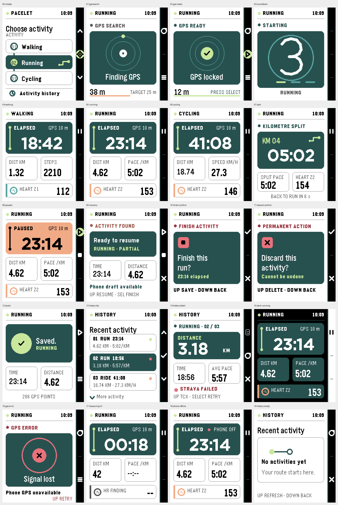
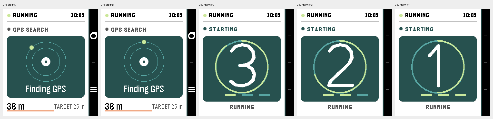

# Route Ribbon: Pacelet design review and Emery concept

**Status:** design proposal, verified with an isolated rendering and
motion preview in the Emery emulator. No Pacelet production app code was
changed. The proposal
sources are [the isolated watch preview](emulator-preview/src/c/main.c) and
[the SVG study generator](../../../tools/render_design_study.js).

## Review scope

I reviewed the watch renderer and controller, configuration page, brand icon
generator, mock screenshot generator, and existing real Emery emulator captures.
The baseline is the actual 200×228 display. Emery supports 64 colors and
native text/vector drawing; it is not limited to the old 144×168 layout.
Pebble's [Emery introduction](https://developer.repebble.com/blog/2016/10/11/Emery-SDK-Beta/),
[image palette guide](https://developer.repebble.com/guides/app-resources/images/),
[system fonts](https://developer.repebble.com/guides/app-resources/system-fonts/),
and [drawing primitives](https://developer.repebble.com/guides/graphics-and-animations/drawing-primitives-images-and-text/)
inform the proposed implementation.

## Findings

| Priority | Finding | Evidence and effect | Design response |
| --- | --- | --- | --- |
| Documentation | Walking intentionally shows steps, but the project notes described live Walking pace. | `draw_activity_screen` in `src/c/watch_ui.c` selects `STEPS` for Walking. The prior `README.md` and `AGENTS.md` wording was stale. | Preserve steps as the Walking dashboard metric and correct the project notes. Walking kilometre splits still show pace. |
| High | Design mocks can hide native-font collisions. | The first isolated Emery pass showed Cycling's `18.74` crossing the gutter toward `27.3`; several values touched card borders. The SVG type did not expose those errors. | Use actual Emery captures as the visual source of truth. Give five-character card values a narrower native font and lift card values away from bottom rules. |
| Medium | The live screen spends most of its area on horizontal bands and dotted rules. | `draw_duration_band`, `draw_metric_row`, and `draw_hr_row` make every metric a full-width row; HR zone color can occupy a large saturated band. | Use one strong elapsed card, two compact metric cards, and a calmer HR strip. |
| Medium | GPS accuracy and its lock target are separated. | Current accuracy sits below the target graphic and the 25 m requirement sits at the bottom. | Put current accuracy and target together below the acquisition graphic. |
| Medium | Waiting, pause, and destructive confirmation share broad yellow surfaces. | `draw_duration_band`, `draw_finish_confirm_screen`, and `draw_recovery_discard_confirm_screen` use similar warning fills. | Use amber for waiting/pause and coral for actions that end or discard a session, with text and icons as second cues. |
| Medium | History and recovery compress important controls into small bottom text. | `draw_history_detail_screen` and `draw_recovery_screen` use terse control strings alongside the action rail. | Give each state a clear title and a separate action line. |
| Medium | Motion is limited to one-second visual ticks. | `activity_controller_handle_tick` increments `anim_tick` once a second. Other state changes redraw immediately. | Add brief, bounded UI-only motion for GPS, countdown, split, and saved acknowledgement. |
| Medium | The phone settings page is a long, uniform form. | `src/pkjs/config_page.js` places appearance, zones, credentials, and recent activities in similar fieldsets. The recent list is text only. | Give daily settings first position, put personal Strava setup in a named advanced section, and make activity status and next action scannable. |
| Low | The pixel route glyph and watch UI do not yet share a visual language. | `tools/generate_brand_assets.js` creates a route symbol while watch screens use generic icons and bands. | Retain the recognizable symbol and repeat its line and endpoint geometry. |

## Visual direction

**Route Ribbon** treats each activity as a visible line in progress. A short
route with circular endpoints appears in menu selection, elapsed time, GPS
lock, splits, recovery, and the saved state. It is geometric and playful
without pretending to display a real map.

The watch's usable content area is 180×228; the rightmost 20 px remain an
action rail aligned to UP, SELECT, and DOWN. A 28 px top bar carries the mode
and clock on every screen. Content uses 8 px horizontal margins, 7–8 px
card corners, 1–2 px rules, and a 6–8 px vertical rhythm. There are no
gradients, shadows, alpha fades, or detailed bitmap backgrounds.

### Palette

All watch colors below are exact members of Emery's 64-color palette.
Contrast ratios are calculated from palette values before sunlight effects.

| Token | Value | Use |
| --- | --- | --- |
| Paper / ink | `#FFFFFF` / `#000000` | Default light surfaces and primary text |
| Deep teal | `#005555` | Route card and selected row; white text is 8.6:1 |
| Cyan | `#00AAAA` | GPS rings and secondary route marks |
| Lime | `#AAFF00` | Current endpoint, locked/selected/saved indicator; 7.0:1 against deep teal |
| Amber | `#FFAA00` | Acquiring GPS and paused state; black text is 11:1 |
| Coral | `#FF5555` | Error and irreversible action; black text is 6.7:1 |
| Dark amber / dark red | `#AA5500` / `#AA0000` | Warning and error text on white; 5.2:1 and 7.8:1 |
| Secondary ink | `#555555` on white; `#FFFFFF` on teal in dark mode | Small labels remain readable |

Dark mode keeps the signal colors, switches the page to black, uses teal
cards, and makes the action rail white. State always has a text or shape cue;
color alone never carries the meaning.

### Type and data hierarchy

- Pebble Gothic 14/18/24/28 for labels, menu titles, and metric values.
- Bitham 42 Bold for typical elapsed time; Bitham 34 Medium Numbers for
  `h:mm:ss`. Compact Gothic values step down again for six-character
  distances.
- A rounded route-stroke numeral fills the countdown ring. Native system
  numerals rendered too small in the 110 px diameter space.
- Units sit with metric labels, so values can be large without losing meaning.
- Live steps, pace, and speed display directly from the current model. Do not
  animate digits between measurements; activity data must never appear
  fabricated.

### Screen treatment

| State | Primary visual and information | Rail actions |
| --- | --- | --- |
| Choose | Three numbered route stops; selected stop becomes teal with a lime endpoint. History is a distinct final row. | Up, enter selected flow, down |
| GPS searching/error/ready | Two rings and a moving endpoint. Current accuracy and the 25 m lock target share a line. Error shows coral and the actual error text. | Refresh, start when locked, change type |
| Countdown | Large numeral inside the route ring, with three progress marks. Clock stays visible. | None |
| Walking/Running/Cycling | Elapsed hero, distance and steps/pace/speed pair, compact HR strip. GPS quality is beside elapsed. | Pause |
| HR measuring / phone disconnected | Keep geometry; show `--` and a finding label, or replace GPS quality with `PHONE OFF` and a coral dot. | Same as current activity |
| Kilometre split | `KM 04` endpoint and split time dominate; split pace/average speed and current HR remain below for six seconds. | Pause |
| Paused | Same metric positions; amber elapsed hero and clear `PAUSED` label. | Resume, finish |
| Recovery | Session summary and phone draft status; action wording matches the rail. | Resume, finish, discard |
| Finish/discard confirmation | Coral action cue, plain-language question, explicit save/delete and back wording. | Confirm, back |
| Saved | Lime endpoint/check with time and distance recap. | Start another, choose type |
| History list/detail | Scannable rows with status dot plus text; detail gives distance, time, average pace/speed, and Strava status. | Navigate; detail: TCX, retry, back |

The [native emulator contact sheet](emulator/contact-sheet.png) contains all
twenty light, dark, and exceptional states captured at 200×228 and displayed
at 2×. Individual native PNGs are in `emulator/`. The [SVG overview](overview.svg)
and individual SVGs in this directory remain editable design studies; native
font sizing and emulator color rendering should be judged from the PNGs.

## Emery verification and design revisions

The [preview app](emulator-preview/) uses a separate UUID and sample data.
Its UP and DOWN buttons cycle through twenty design states and one
long-value stress state. Running
`python3 capture.py` from that directory builds only the preview app,
installs it into the Emery emulator, and captures the screen set. This
exercises Pebble's C drawing API, 200×228 frame buffer, and native fonts
without modifying or installing Pacelet.

| First emulator pass | Revision checked in the final captures |
| --- | --- |
| Cycling's five-character distance ran into the adjacent speed card. | Use Gothic 24 Bold for values of five or more characters and preserve the 8 px gutter. [Cycling](emulator/06-cycling.png) now shows both values separately. |
| Split, recovery, saved, and history values sat against card borders. | Move values up by 3–4 px and reduce long times to Gothic 24 Bold. [Split](emulator/07-split.png), [recovery](emulator/09-recovery.png), and [history detail](emulator/14-history-detail.png) have visible lower padding. |
| A system-font countdown numeral looked small inside the route ring. | Draw a large rounded route numeral with short line segments. [Countdown](emulator/03-countdown.png) now uses the ring's height. |
| The SVG study had overlarge elapsed and saved text and stale Walking pace. | Resize the SVG type, shorten crowded copy, and show the intentional Walking steps metric. [Walking](emulator/04-walking.png) is the native reference. |
| Long activity values needed a separate fit check. | The [stress capture](emulator/20-edge-long-values.png) fits `1:23:45`, `128.74` km, `12:34` pace, and 179 bpm without crossing the card gutter or rail. |

The emulator displays the encoded 64-color palette with a softer,
less saturated appearance than the raw SVG hex colors. The native captures
should guide final palette decisions. On GPS search or Countdown, SELECT
starts a timer-driven preview. GPS frames [A](emulator/motion-gps-a.png)
and [B](emulator/motion-gps-b.png) show the endpoint moving; countdown
frames [3](emulator/motion-countdown-a.png),
[2](emulator/motion-countdown-b.png), and
[1](emulator/motion-countdown-c.png) show the advancing ring and numeral.
`python3 capture_motion.py` reproduces these samples.
The [browser motion preview](motion-preview.html) also shows the intended
sequence. The remaining transitions, physical-watch frame pacing, and
battery impact still need validation before production work.

## Motion language

Movement follows the route endpoint. It clarifies a state change and stops
once the state is stable. No loop runs on the live metrics screen.

| Event | Motion | Duration and redraw budget |
| --- | --- | --- |
| Menu selection | Endpoint slides to the next stop; selected card fills after it arrives. | 160 ms, roughly 8–10 frames |
| GPS searching | One endpoint travels around the outer ring. On lock, it moves to the center and becomes a check. | 8 frames per orbit for the first 10 s; reduce to 4 frames/s for a prolonged search. Stop on ready/error/exit. |
| Countdown | Ring advances in ten steps per second; numeral changes once per second with a brief position accent. | 100 ms timer during the existing 3 s countdown only |
| New HR sample | A single 2 px pulse on the heart outline. | 220 ms, capped at one per second; no loop |
| Kilometre split | Marker enters from below and time settles into its card. Hold for the existing six seconds, then leave. | 240 ms in, 180 ms out; split timer remains authoritative |
| Paused/resumed | Hero changes state through a short route-line sweep; values retain positions. | 180 ms |
| Saved | Endpoint becomes a check, then summary appears. | 300 ms, one shot |

Implement motion in `watch_ui.c` with one UI-owned timer and small integer
phase values; cancel it on state changes and unload. The controller remains
responsible for countdown and split timing. Keep button responses immediate.
Monitor emulator frame time and device battery impact before choosing final
frame rates.

## Phone and brand follow-through

The phone configuration page can carry the route header and palette in CSS,
while preserving the current fields and storage format. The initial view
should show Appearance, Heart Rate Zones, and Recent Activities. Personal
Strava setup can be a clearly labeled advanced section with its
credential-storage explanation retained. A recent row should show type,
date, distance, time, upload state, and available export/retry path. Do not
display credentials in decorative summaries or previews.

The [phone settings concept](phone-settings.svg) shows this structure alongside
the watch screens. Its form controls are visual placeholders; save behavior
would stay with the existing configuration flow.

The existing app icon already contains a route endpoint. A production pass
should align its colors and geometry with this system and regenerate the
25 px menu and store sizes together, preserving the app identity.

## Implementation and acceptance

1. Rebuild common chrome, rail, metric card, and route primitive in
   `src/c/watch_ui.c`; keep business state in the existing model/controller.
2. Preserve Walking steps and ensure the split view still reports Walking
   kilometre pace.
3. Add bounded UI motion, then update all watch states, phone page, and icon.
4. Update `tools/render_screenshots.js` to match the shipping UI. Capture the
   real emulator flow and keep those captures out of Git as instructed.
5. Verify `mm:ss`/`hh:mm:ss`, large distances, missing HR, GPS error and
   phone loss, light/dark contrast, ten history items, cycling split speed,
   and all rail actions on Emery. Run `npm test`, `pebble build`, and
   `npm run screenshots:emulator:all`.

This study does not change the watch binary, phone page, or app-store assets.
